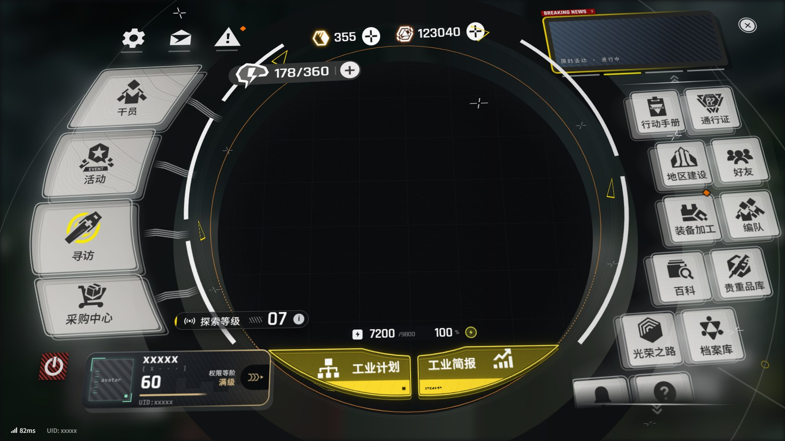

# Endfield Menu

A fan-made recreation of the *Arknights: Endfield* main menu, written in plain HTML, CSS and JavaScript — no build step, no dependencies.



> **Unofficial fan work.** This project is not affiliated with, endorsed by or connected to Hypergryph, Gryphline or the *Arknights: Endfield* team. *Arknights: Endfield* is a trademark of its respective owners. The icons on the menu buttons, the counter badges of the top bar, the permission-tier emblem of the player badge and the radar on the level pill are redrawn as SVG from a screenshot of the game: they are Hypergryph's artwork, live in `components/button-art.js` and are **not** covered by this project's license. The background's colour field (`components/backdrop-field.js`) and the contour lines on the top two cards (`components/card-contours.js`) are taken from the same screenshot and are excluded too. Every other icon, texture and shape is drawn from scratch in SVG/CSS. The map in the middle of the disc is intentionally left blank, and the player name and UID are placeholders (`xxxxx`).

## Features

- **Real 3D scene.** One perspective camera looks down at a tilted plane. UI groups float at different heights, and the dial rings stack like a cylinder. The camera sways with the mouse through a small spring.
- **Background matched to the game.** The blurred game world behind the menu is a smooth colour field sampled from a screenshot. Thin circles, a straight line, a small yellow ring and nine "+" marks float in the 3D scene at coordinates measured from the screenshot, so they shift with the camera like the rest of the menu.
- **View-dependent shadows.** Every card, tile and button has a "back plate" copy that leans with the camera angle. The shadow values are quantized, so a resting camera triggers no style work.
- **Opening and closing transitions** timed frame by frame from captures of the game's menu. On open, the backdrop cuts to the dimmed world and the disc grows in flat, then tilts up to face the camera over a transition skeleton (a dotted disc, a cyan reticle and a sweeping dark ring). The map is revealed from the top of the disc, the cards and tiles slide in from the disc's side, and the readouts blink on. On close, the cards jump out and implode, the tiles clear from the bottom up and slide away, the disc tips back and shrinks, and the backdrop cuts back. The entrance replays every time the menu reopens.
- **Hover and carousel as in the game:** cards and tiles lift and brighten under the pointer and sink when pressed, and the news slides push each other sideways.
- **Scrollable right column** with all 18 of the game's tiles. Supports wheel easing, drag with rubber-band overscroll, flick inertia and spring-back.
- **Breaking-news carousel**, notification markers, a level pill, an energy readout, currencies and stamina.
- Respects `prefers-reduced-motion`: the entrance, exit and idle animations are skipped and the camera stays still.

## Run it

Open `index.html` in a browser. That's it.

You can also serve the folder with any static file server:

```bash
npx serve .
```

The fonts (Rajdhani, Noto Sans SC, Inter, JetBrains Mono) load from Google Fonts. Offline, the page falls back to system fonts.

Developed and tested in Chromium-based browsers (Chrome, Edge). The page relies on `@property`, `transform-style: preserve-3d` and the individual `scale` property.

**Controls**

| Input | Action |
| --- | --- |
| Mouse move | Sway the camera |
| Mouse wheel / drag over the right column | Scroll the tiles |
| `Esc`, the ✕ button or the red power button | Close the menu |
| `Esc` again, or click the hint at the bottom | Reopen the menu (the entrance plays again) |

## Project structure

```
index.html                  page skeleton, design tokens, the backdrop's open/close cuts and shared keyframes
components/
  shared-defs.js            SVG icon sprite + EF.addStyle() and EF.labelSVG() helpers
  button-art.js             button icons, counter badges, the badge's tier emblem and the level pill's radar redrawn as SVG from the game (© Hypergryph, not covered by the license)
  shared-geometry.js        disc geometry (centre, bezel radius, column radius) + arc helper
  shared-scene.js           3D camera, layers, depth compensation, shadow lean
  backdrop-field.js         background colour field sampled from the game (not covered by the license)
  backdrop.js               paints the background and places the floating 3D decorations
  card-contours.js          contour lines on the top two cards, traced from the game (not covered by the license)
  hud.js                    system buttons, power button, close button, ping/UID line
  top-bar.js                currencies and stamina pill
  news-panel.js             "Breaking News" carousel
  player-badge.js           player card
  left-cards.js             the four left cards and their cables
  right-tiles.js            the scrollable two-column tile grid
  disc.js                   the central well with its empty map (put your own content here) and the disc's open/close pose
  transition-skeleton.js    dotted disc, reticle and dark ring shown only while the menu opens or closes
  dial-rings.js             ring planes around the disc and the swaying flags
  level-pill.js             exploration level pill
  energy-pill.js            energy readout
  disc-buttons.js           the two yellow buttons under the disc
  app.js                    mounts everything, fits the 1920×1080 stage, open/close and entrance
```

Each component injects its own stylesheet, declares its markup, and exposes a `mount(...)` function on the shared `EF` namespace. `app.js` decides which scene layer each one goes into.

## Customizing

- **Labels and icons** live in small data arrays at the top of each component: `CARDS` in `left-cards.js`, `TILES` in `right-tiles.js`, `SLIDES` in `news-panel.js` and `BUTTONS` in `disc-buttons.js`. Each button names its icon (`art`, an id in `button-art.js`, or `icon`, a symbol in `shared-defs.js` as the last two tiles do) and lays its label out with `text`: the font size, each character's position and an optional lean matrix, measured from the game.
- **Handling clicks:** buttons report their `data-action` through a DOM event:

  ```js
  document.addEventListener("ef-action", (e) => console.log(e.detail.action));
  ```

- **The centre of the disc** (`.ef-core__map`, inside the round well `.ef-core__win` in `disc.js`) is an empty map that sits inside the 3D cylinder. Drop your own map, chart or artwork in there: on open it is revealed from the top of the disc like the game's map, and on close it blinks out.
- **Timing:** each component writes its entrance and exit times as absolute delays in its `body.ef-in` / `body.ef-out` rules. The whole entrance must end within 900 ms and the exit within 500 ms (`ENTRANCE_MS` / `EXIT_MS` in `app.js`). `index.html` keeps the backdrop's cuts (`--ef-in-cut`, `--ef-out-cut`) and the stage's fade (`--ef-out-fade`); read them only in rules that select through `body.ef-in` / `body.ef-out`, and let those rules name their subjects by class, so the two classes restyle only the animated parts.

## License

[GNU General Public License v3.0 or later](LICENSE) (GPL-3.0-or-later). You may use, study, modify and share this project, commercially or not; anything you distribute that is based on it must be released under the same license, with its source code.

The license does not cover `components/button-art.js`, `components/backdrop-field.js` and `components/card-contours.js`: the icons are *Arknights: Endfield* artwork © Hypergryph, redrawn for this fan recreation, the background colours are sampled from a screenshot of the game, and the card contour lines are traced from it. Replace them with your own artwork if you need everything under one license.

---

### 中文说明

《明日方舟：终末地》主菜单的同人复刻，纯 HTML / CSS / JS，无需构建，直接用浏览器打开 `index.html` 即可。

本项目为非官方同人作品，与鹰角网络（Hypergryph）、Gryphline 及《明日方舟：终末地》官方无关，也未获其认可。菜单按钮上的图标、顶栏计数器的徽标、玩家徽章的权限等阶徽记与探索等级的雷达图标根据游戏截图重绘为 SVG，属于鹰角网络的美术作品，位于 `components/button-art.js`；背景色场采样自同一张截图，位于 `components/backdrop-field.js`；顶部两张卡上的等高线也由该截图逐线描摹，位于 `components/card-contours.js`。这三个文件不在本项目许可范围内；其余图标与图形均为自绘，背景中漂浮的线条与十字标记按截图测得的三维坐标摆放。圆盘中央的地图有意留空，玩家名与 UID 均以 `xxxxx` 占位。许可证为 GNU GPL v3.0 或更高版本（GPL-3.0-or-later）：可自由使用、修改和分发（包括商用），但分发本项目或其衍生作品时须采用同一许可证并提供源代码。
